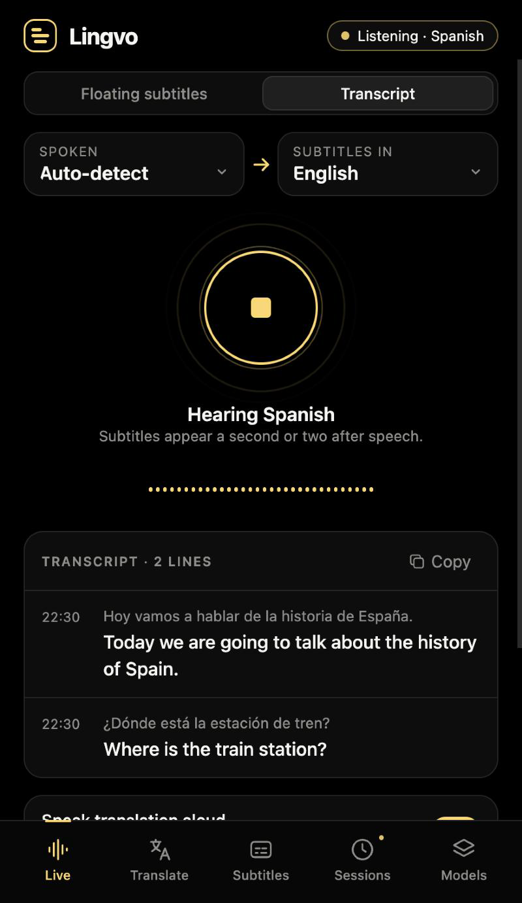
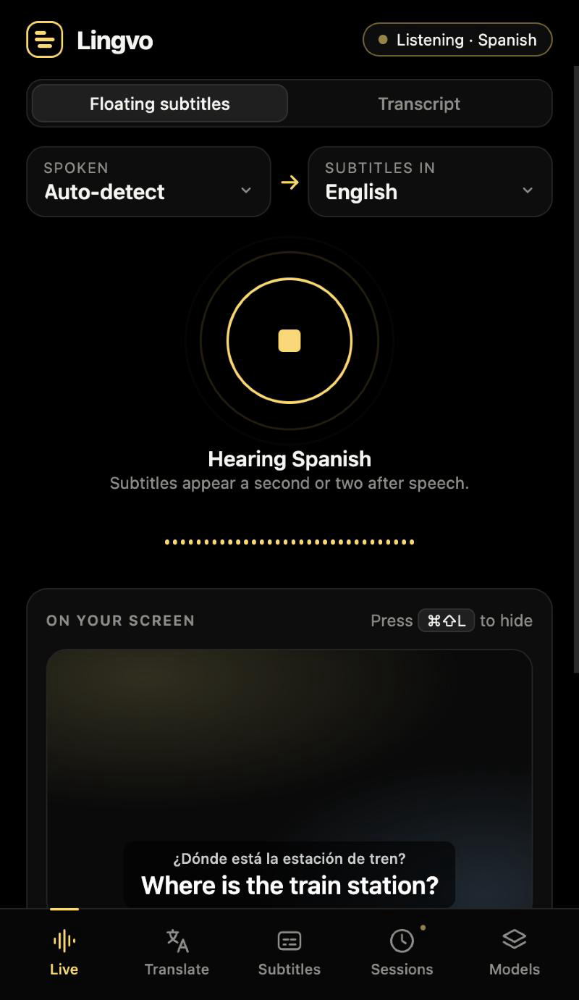
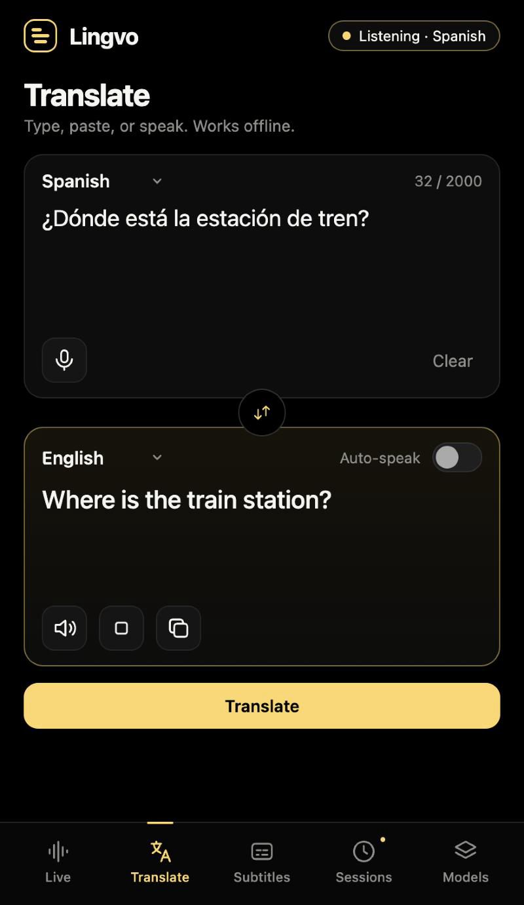
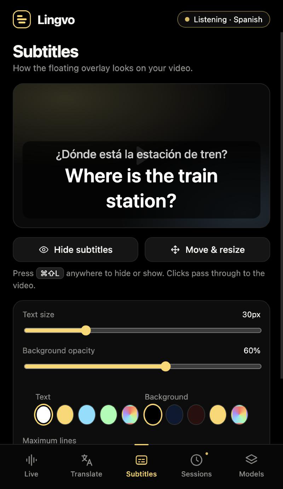
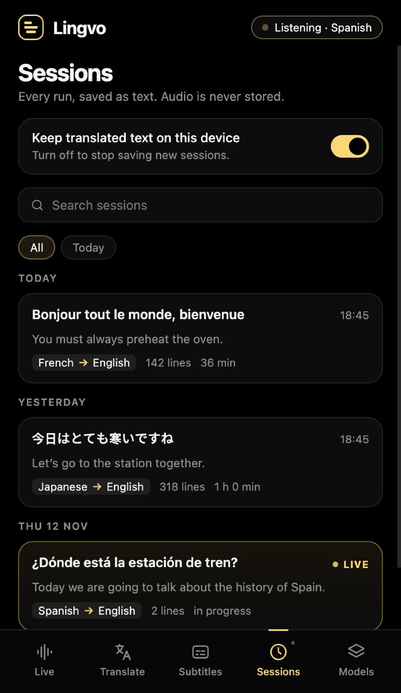
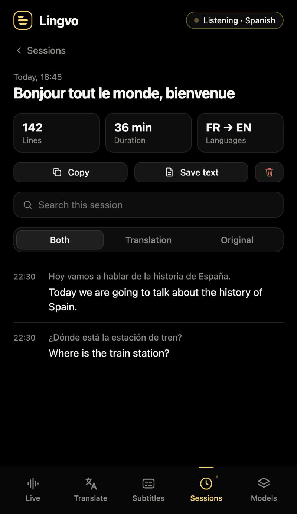
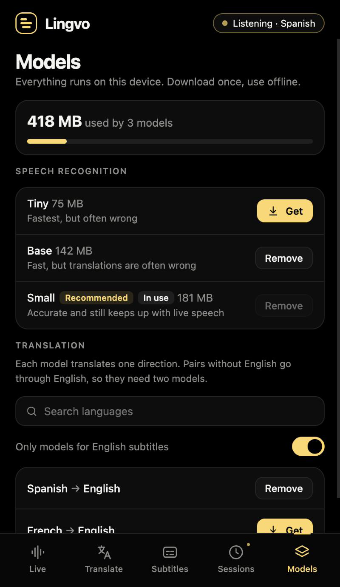
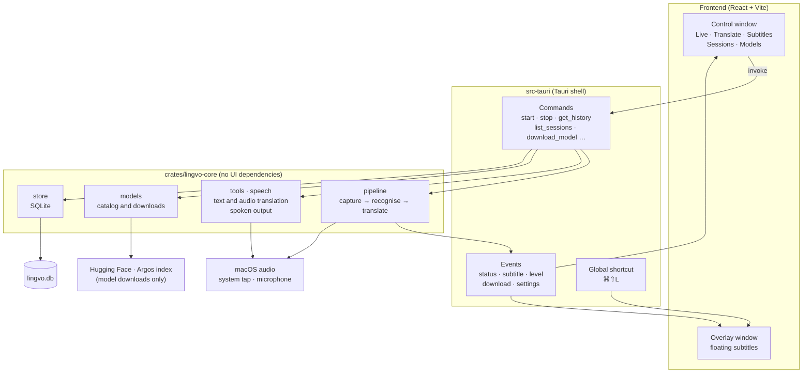
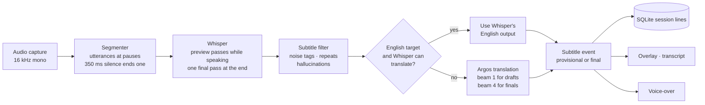
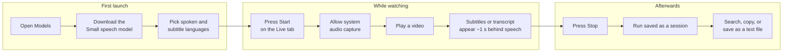

<div align="center">


# Lingvo

**Live subtitles and voice-over for anything your computer plays — recognised, translated, and shown on your device. No accounts, no cloud, no cost.**

<br/>

[](https://tauri.app/)
[](https://www.rust-lang.org/)
[](https://react.dev/)
[](https://www.typescriptlang.org/)
[](https://vite.dev/)
[](https://github.com/ggerganov/whisper.cpp)
[](https://github.com/OpenNMT/CTranslate2)
[](https://www.sqlite.org/)
[](https://pnpm.io/)
[](#local-development)
[](#local-development)
[](./LICENSE)

</div>

---
# 🔗 Source — [yuvrajsatyapal/Lingvo](https://github.com/yuvrajsatyapal/Lingvo)
---

## Table of Contents

- [Screenshots](#screenshots)
- [Project Overview](#project-overview)
- [Key Features](#key-features)
- [Tech Stack](#tech-stack)
- [System Architecture](#system-architecture)
- [Live Pipeline Design](#live-pipeline-design)
- [Folder Structure](#folder-structure)
- [Data Storage](#data-storage)
- [Speech and Translation Models](#speech-and-translation-models)
- [Command and Event Reference](#command-and-event-reference)
- [Settings Reference](#settings-reference)
- [Local Development](#local-development)
- [Testing and Benchmarking](#testing-and-benchmarking)
- [Performance](#performance)
- [Privacy and Security](#privacy-and-security)
- [Project Workflow](#project-workflow)
- [Known Limits](#known-limits)
- [License](#license)

---

## Screenshots

The app is a compact 440 × 760 window (resizable up to 520 × 900) with a black and yellow design and a bottom navigation bar.

### Live
Pick the spoken and subtitle languages, press the yellow button, and watch lines arrive as people speak. In **Transcript** mode every line shows the original words above the translation.

| Transcript | Floating subtitles |
|---|---|
|  |  |

### Translate
Translate typed text or a microphone recording, then read, listen to, or copy the result.



### Subtitles
Style the floating overlay with a live preview: size, opacity, colors, line count, and whether to show the original words.



### Sessions
Every Start → Stop run is saved as a session. Browse them by day, search, and open one to replay its timeline.

| Session list | Session detail |
|---|---|
|  |  |

### Models
See what is installed and how much space it uses. Download or remove speech and translation models. The recommended speech model is tagged.



---

## Project Overview

Foreign-language video is everywhere and subtitles are rarely there when you need them. Lingvo listens to the audio your Mac is playing, recognises the speech, translates it, and shows subtitles in a floating overlay or saves a transcript, all on your device.

**Who it is for:**
- Anyone watching lectures, streams, films, or meetings in a language they do not speak
- Language learners who want the original words next to the translation
- People who prefer a voice-over: Lingvo can speak each translated sentence aloud
- Privacy-minded users who do not want their audio sent to a cloud service

**Key problems it solves:**

| Problem | Lingvo solution |
|---|---|
| Video has no subtitles in your language | Live recognition and translation of any system audio |
| Cloud captioning services need accounts and send your audio away | Everything runs locally; the network is used only to download models |
| Subtitles lag far behind speech | Streaming previews and early sentence release, about 1 s behind speech |
| Wrong translations from small models | A recommended model that was measured against alternatives (see [Performance](#performance)) |
| Losing what you watched | Sessions: every run is saved as searchable text you can copy or export |
| Wanting to hear, not read | Optional spoken translation with the original audio muted |

---

## Key Features

### Live Translation
- Captures **system audio** (everything playing) or a chosen **microphone / input device**
- **Automatic language detection**, or pin the spoken language
- Two output modes: **floating subtitles** over your video, or a **transcript** with the original words
- Streaming **provisional text** that is replaced by a finished line, so subtitles appear while a sentence is still being spoken
- Long sentences are released clause by clause instead of waiting for a pause
- Filters noise tags, repeated lines, and Whisper's known silence hallucinations
- Warns when the chosen speech model is too slow for live use on this computer

### Voice-Over (Live Dubbing)
- Speaks each finished translated sentence with the built-in macOS voices
- Optionally **mutes the original audio** while the voice-over plays
- Lingvo's own voice is excluded from capture, so it never translates itself

### Translator
- Translate typed text, or record from the microphone with automatic language detection
- Swap languages, listen to the result, copy it, or enable auto-speak

### Subtitle Overlay
- Always-on-top, click-through window designed to float above other apps, including fullscreen video (not yet verified over every fullscreen app)
- Adjustable text size, background opacity, text color, background color, and 1–3 lines
- Optional second line with the original words
- **Move and resize** mode, with the position remembered between launches
- **⌘⇧L** hides or shows the overlay from anywhere

### Sessions
- Every Start → Stop run becomes a session, grouped by day, newest first
- The running session is pinned to the top and updates live
- Session detail with duration, line count, language pair, and a timestamped timeline
- Search across sessions and inside a session, with matches highlighted
- View both languages, translation only, or original only
- Copy, save as a text file (`Documents/Lingvo`), delete one session, or clear everything
- A switch to stop saving translated text entirely

### Models
- One place to download and remove speech and translation models, with progress
- Storage summary and an **In use** / **Recommended** tag on speech models
- Searchable list of translation pairs, filtered to the current subtitle language by default
- More than **45 languages**; pairs without English pivot through English

### Interface
- Black and yellow design system, designed for a small always-open window
- Bottom navigation with a live indicator on Sessions while recording
- Respects `prefers-reduced-motion`; keyboard-focus outlines on every control

---

## Tech Stack

| Layer | Technology | Purpose |
|---|---|---|
| **Desktop shell** | Tauri 2 | Native window, commands, events, overlay, global shortcut |
| **Backend language** | Rust 2021 | Audio, recognition, translation, storage |
| **Frontend** | React 19 + Vite 8 | The control window and the overlay window |
| **Language** | TypeScript 5.9 | Typed UI and command bindings |
| **Speech recognition** | whisper.cpp via `whisper-rs` (Metal, flash attention) | On-device speech-to-text and speech-to-English |
| **Translation** | Argos Translate packages on CTranslate2 (`ct2rs`) | Offline text translation, pivoting through English |
| **Tokenizing** | SentencePiece + a BPE implementation | Matches each Argos package's tokenizer |
| **Audio capture** | `cpal` 0.18 (vendored, patched) | macOS system-audio tap and input devices |
| **Voice activity** | Custom energy-based segmenter | Cuts the stream into utterances at pauses |
| **Speech output** | macOS `say` voices | Voice-over and Translator playback |
| **Storage** | SQLite (`rusqlite`, bundled) | Settings and session history |
| **Downloads** | `reqwest` (rustls) | Model downloads, the only network use |
| **Async** | Tokio | Downloads and background tasks |
| **Package manager** | pnpm | Frontend dependencies |

---

## System Architecture



---

## Live Pipeline Design

The pipeline runs on its own thread so nothing in it can block the UI. Audio flows through five stages and comes out as subtitle events.



How a line gets on screen:

1. **Segment.** The segmenter cuts the stream into utterances at pauses. A pause of 350 ms ends one; a very long utterance is cut at its quietest recent point.
2. **Preview.** While someone is speaking, the utterance so far is recognised again every ~450 ms (Fast mode). The unfinished tail is shown as provisional text.
3. **Release early.** Sentences that more speech has followed are published as final straight away, so they are not held back until the speaker stops. Long sentences are released at a comma.
4. **Finish.** When the utterance ends, the remainder is recognised (or the last preview is reused when only the pause followed it) and published as final.
5. **Align.** Whisper may reword text it has already published, so the unpublished remainder is located by sentence count, then by the last published words, then by word count.
6. **Translate.** Into English, Whisper can output English directly. Otherwise Argos translates; drafts use a greedy search and finished lines use a beam of 4.

---

## Folder Structure

```
lingvo/                          ← Cargo workspace + pnpm project root
├── crates/
│   └── lingvo-core/             ← All logic, no UI dependencies
│       ├── src/
│       │   ├── audio/           ← System-audio loopback and inputs, resampling to 16 kHz
│       │   ├── asr.rs           ← Whisper recogniser (flash attention, warm-up)
│       │   ├── vad.rs           ← Energy-based utterance segmenter
│       │   ├── subtitle.rs      ← Noise tags, repeats, hallucination filter
│       │   ├── translate.rs     ← Argos packages on CTranslate2, English pivoting
│       │   ├── bpe.rs           ← BPE tokenizer for packages without SentencePiece
│       │   ├── pipeline.rs      ← Capture → recognise → translate → subtitle loop
│       │   ├── tools.rs         ← On-demand text and audio translation
│       │   ├── speech.rs        ← Spoken output through macOS voices
│       │   ├── models.rs        ← Model catalog and downloads
│       │   ├── store.rs         ← SQLite settings, history, session summaries
│       │   └── types.rs         ← Settings and event types
│       └── examples/probe.rs    ← Headless benchmarks and live-pipeline replay
│
├── src-tauri/                   ← Desktop shell
│   ├── src/lib.rs               ← Commands, overlay window, shortcut, window setup
│   ├── tauri.conf.json          ← Window sizes and bundle config
│   ├── Info.plist               ← Audio-capture and microphone usage strings
│   ├── capabilities/            ← Tauri permissions
│   └── icons/                   ← App icon in every size (source: icon-source.svg)
│
├── src/                         ← React frontend
│   ├── main.tsx                 ← Chooses the control or overlay window
│   ├── Control.tsx              ← Shell: header, bottom navigation, toast, state
│   ├── Live.tsx                 ← Start button, waveform, transcript, options
│   ├── Translator.tsx           ← Text and microphone translation
│   ├── Subtitles.tsx            ← Overlay style settings with live preview
│   ├── Sessions.tsx             ← Session list, detail, search, delete
│   ├── Models.tsx               ← Model downloads and storage summary
│   ├── Overlay.tsx              ← The floating subtitle window
│   ├── ui.tsx                   ← Icons, switch, segmented control, helpers
│   ├── api.ts                   ← Typed command and event bindings
│   ├── dev-mock.ts              ← Sample data so the UI runs in a plain browser
│   ├── langs.ts                 ← Language names
│   └── styles.css               ← Design tokens and components
│
├── vendor/cpal/                 ← cpal with a small macOS patch (see LINGVO_PATCH.md)
├── prototype/                   ← Standalone HTML design prototypes
└── docs/images/                 ← README screenshots
```

---

## Data Storage

Everything lives in the app's data directory (`~/Library/Application Support/com.lingvo.app/`).

| Path | Contents |
|---|---|
| `lingvo.db` | SQLite: settings (one JSON row) and translated lines |
| `models/whisper/` | Downloaded Whisper `.bin` files |
| `models/translate/<from>_<to>/` | Extracted Argos packages |
| `models/argos-index.json` | Cached list of available translation packages |
| `~/Documents/Lingvo/` | Text files you export from a session |

**Sessions are derived, not stored separately.** Each saved line carries a `session_id` (the start time in milliseconds), and the session list is a grouped query over the `history` table:

```sql
CREATE TABLE history (
  id          INTEGER PRIMARY KEY AUTOINCREMENT,
  created_at  TEXT NOT NULL,      -- UTC, ISO 8601
  source_lang TEXT,
  target_lang TEXT NOT NULL,
  original    TEXT,
  translated  TEXT NOT NULL,
  session_id  INTEGER             -- groups one Start → Stop run
);
```

A session's title is its first spoken line, its duration is first line to last line, and deleting a session deletes its rows. Audio is never written to disk.

---

## Speech and Translation Models

### Speech recognition (Whisper)

Measured on an Apple M2, French speech to English, through the live pipeline:

| Model | Size | One pass | Result | Notes |
|---|---|---|---|---|
| Tiny | 75 MB | fastest | often wrong | Only for very slow machines |
| Base | 142 MB | ~0.15 s | mistranslates, drops sentences | Fast but unreliable for translation |
| **Small** (q5_1) | 181 MB | ~0.45 s | accurate | **Recommended default** |
| Large v3 Turbo (q5_0) | 547 MB | ~1.7 s | most accurate | Too slow for live subtitles; fine for the Translator tab. Needs a translation model because it cannot output English itself |

Whisper always encodes a padded 30 s window, so one pass costs about the same for 2 s or 8 s of speech. That fixed cost, not decoding, is what limits live latency.

### Translation (Argos Translate)

- Each package translates **one direction**. Into English from a supported language needs no extra download when Whisper can translate directly.
- Pairs without English go **through English** and need two packages.
- Finished lines use a beam of 4; provisional lines use a greedy search.

---

## Command and Event Reference

The frontend talks to Rust through typed `invoke` calls defined in [`src/api.ts`](src/api.ts).

### Commands

| Group | Commands |
|---|---|
| **Settings** | `get_settings`, `save_settings` |
| **Audio** | `list_audio_sources` |
| **Engine** | `get_status`, `start`, `stop` |
| **Models** | `list_models`, `download_model`, `delete_model` |
| **History and sessions** | `get_history`, `list_sessions`, `delete_session`, `clear_history`, `export_transcript`, `reveal_file` |
| **Translator** | `translate_text`, `record_start`, `record_stop`, `speak`, `stop_speaking` |
| **Overlay** | `set_overlay_visible`, `get_overlay_state`, `set_overlay_edit` |

### Events (backend → UI)

| Event | Payload | Used for |
|---|---|---|
| `status` | state, message, detected language, running, session id | Header pill, Start button, headline |
| `subtitle` | text, original, language, final flag, latency | Overlay, live transcript |
| `level` | input level 0..1 | Waveform |
| `download` | key, bytes done, total, status | Model progress |
| `settings` | full settings object | Keeps both windows in sync |
| `overlay-visible`, `overlay-edit` | boolean | Overlay controls |

---

## Settings Reference

| Setting | Values | Meaning |
|---|---|---|
| `sourceLang` | `auto` or a language code | Spoken language |
| `targetLang` | language code | Subtitle language |
| `audioSource` | `system` or `input:<device>` | What to listen to |
| `whisperModel` | `tiny`, `base`, `small`, `turbo` | Speech model (default `small`) |
| `mode` | `fast`, `accurate` | Fast shows provisional text sooner; Accurate uses beam search and waits for pauses |
| `englishViaWhisper` | boolean | Let Whisper translate straight to English |
| `outputMode` | `subtitles`, `transcript` | Overlay, or stored original + translation |
| `saveHistory` | boolean | Keep translated text on this device |
| `speakTranslation` | boolean | Voice-over each finished sentence |
| `muteOriginal` | boolean | Silence the original audio during voice-over |
| `overlay.*` | size, colors, opacity, lines, show original | Subtitle appearance |

---

## Local Development

### Prerequisites

| Tool | Notes |
|---|---|
| macOS 14.6+ on Apple Silicon | Windows and Linux are not built yet |
| Rust (stable) | `rustup` |
| Node.js + pnpm | `npm install -g pnpm` |
| cmake | `brew install cmake` (builds whisper.cpp) |

### Setup

```bash
# 1. Clone
git clone https://github.com/yuvrajsatyapal/Lingvo.git
cd Lingvo

# 2. Install frontend dependencies
pnpm install

# 3. Run the desktop app in development
pnpm tauri dev
```

On first use, open **Models**, download the **Small** speech model, press **Start** on the Live tab, and allow "record system audio" when macOS asks. `⌘⇧L` hides or shows the subtitles.

> **System-audio permission.** macOS grants system-audio capture to a real app bundle. If `pnpm tauri dev` does not receive audio, build and open the bundle instead:
>
> ```bash
> pnpm tauri build --debug --bundles app
> open target/debug/bundle/macos/Lingvo.app
> ```

### Development Commands

```bash
pnpm dev                 # UI only, in a browser, with sample data (no Rust needed)
pnpm tauri dev           # Full desktop app with hot reload
pnpm build               # Typecheck and production frontend build
pnpm tauri build         # Release bundle and DMG
cargo test -p lingvo-core
```

`pnpm dev` alone opens the UI in a browser backed by [`src/dev-mock.ts`](src/dev-mock.ts), which is handy for layout work.

### Development Environment Variables

| Variable | Effect |
|---|---|
| `LINGVO_MODELS` | Model folder used by the `probe` tool |
| `LINGVO_DEBUG=1` | Logs why lines were dropped and when previews are reused |
| `LINGVO_AUTOSTART=1` | Starts translating on launch and logs events |
| `LINGVO_DUMP=<file>` | Writes the captured 16 kHz mono audio as raw `f32` |

---

## Testing and Benchmarking

```bash
cargo test -p lingvo-core
```

The unit tests cover the segmenter, subtitle filter, sentence splitting, published-text alignment, preview reuse, translation routing, and the session queries.

The headless **probe** replays audio through the real pipeline at real-time speed, which is how the model and latency numbers in this README were measured:

```bash
export LINGVO_MODELS="$HOME/Library/Application Support/com.lingvo.app/models"
cargo build --release -p lingvo-core --example probe

probe=target/release/examples/probe
$probe stream clip.wav en small      # live pipeline, prints when each line appears
$probe asrtime clip.wav small        # recognition pass timing at 2, 4 and 8 s
$probe mt fr en "Bonjour à tous."    # translation quality and speed
$probe install whisper small         # download a model
```

Test clips can be generated with the macOS `say` command and converted with `afconvert -f WAVE -d LEI16@16000 -c 1`.

---

## Performance

| Measure | Result (M2, French to English, Small model) |
|---|---|
| Speech recognition pass | ~0.45 s (about 20% faster with flash attention) |
| End of speech to finished line | ~1.1 s (was ~1.6 s before the latency work) |
| Translation of one sentence | ~0.3–0.45 s with a beam of 4 |

What was tried:

| Change | Outcome |
|---|---|
| Flash attention on Metal | Kept: ~20% faster, identical output |
| Reuse the last preview for the final line | Kept: skips a recognition pass when only the closing pause followed it |
| Beam 4 for finished translations | Kept: same cost as beam 2, fewer wrong word choices |
| Shrinking Whisper's encoder window (`audio_ctx`) | Rejected: much faster, but dropped and reworded sentences |
| More translation threads | No effect: decoding is overhead-bound, not compute-bound |

---

## Privacy and Security

- **Everything runs on your device.** Audio is never uploaded and never saved. The network is used only to download models and the translation package list.
- **Permissions are explicit.** The app declares why it needs audio capture and the microphone in [`Info.plist`](src-tauri/Info.plist), and macOS asks before granting either.
- **Text history is optional.** Turn off "Keep translated text on this device" to stop saving sessions; delete one session or everything at any time.
- **Models are downloaded over HTTPS** from Hugging Face and the Argos package index.
- **The overlay is click-through** outside move-and-resize mode, so it never steals input from your video.

---

## Project Workflow



---

## Known Limits

- Lines trail speech by roughly 1 s, because Lingvo only hears audio after it plays. A sentence is released once the next one starts or the speaker pauses.
- Translating into English works with no extra download. Other targets need translation models, two of them when neither language is English.
- Music or several voices at once reduce accuracy.
- Lines saved before sessions existed have no session id, so they do not appear in the Sessions list.
- Not yet verified: DRM-protected streaming sites, and the overlay above every fullscreen app.

---

## License

MIT License — see [LICENSE](./LICENSE) for details.
